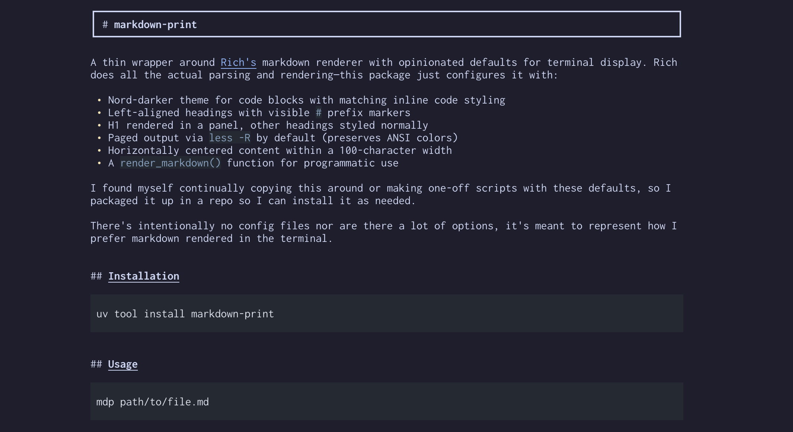

# markdown-print

A thin wrapper around [Rich's](https://github.com/Textualize/rich) markdown
renderer with opinionated defaults for terminal display. Rich does all the
actual parsing and rendering, this package just configures it with:

- Nord-darker theme for code blocks with matching inline code styling
- Left-aligned headings with visible `#` prefix markers
- H1 rendered in a panel, other headings styled normally
- An interactive reader with mouse selection and clipboard copying
- Horizontally centered content within a 100-character width
- A `render_markdown()` function for programmatic use

I found myself continually copying this around or making one-off scripts
with these defaults, so I packaged it up in a repo so I can install it
as needed.

There's intentionally no config files nor are there a lot of options, it's
meant to represent how I prefer markdown rendered in the terminal.

<p align="center">
  
</p>

## Installation

```sh
uv tool install markdown-print
```

## Usage

```sh
mdp path/to/file.md
```

Drag across any part of the document and release to copy the highlighted
text. Paste normally in another app. The copy omits the centering margin
and code-block padding, preserves code indentation, and contains no color
escape sequences. Rendered line breaks and visible Markdown decorations
(such as list bullets) are preserved.

You can also press `Ctrl+C` or `y` to copy the selection again. `Esc` clears
it. Use the mouse wheel or arrow keys to scroll, `Space`/`b` to page down/up,
`g`/`G` to jump to the beginning/end, and `q` to quit. `/` opens search;
press `Enter` to find text and `n`/`N` for the next/previous matching line.

Copying uses `pbcopy` on macOS, or `wl-copy`, `xclip`, or `xsel` when
available on Linux. Otherwise, including over SSH, it sends a clipboard
request to your terminal using OSC 52. The terminal must support and allow
these requests; the status bar distinguishes a native copy from a request
sent to the terminal. Drag without holding `Shift`, which many terminals
reserve for their own selection (including the centering spaces).

Use `--pager less` for the original `less -R` reader, or `--no-page` to
print directly. The default reader prints normally when input or output
is redirected. Clean mouse copying is available in the interactive reader.

## Development

This project requires Python 3.12 and uses
[uv](https://github.com/astral-sh/uv) to manage dependencies.

You can create a virtual environment with all the necessary dependencies
by running:

```sh
uv sync --all-extras --dev
```

This will install all necessary dependencies and install this project
in editable mode.

You can activate the venv with:

```sh
. .venv/bin/activate
```

## Releases

To publish a new pypi release, bump all the version, create a git tag,
and push everything up to GitHub.  There's a helper script you should use:

```
$ ./scripts/stage-release patch

... omitted ...
You can now run:

git push origin main --tags


$ git push origin main --tags
```
